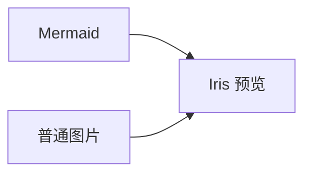

# VitePress Mermaid 与图片预览

`vitepress-plugin-mermaid-image-preview`。把 Mermaid 图表和普通图片接入同一个可缩放、可平移的预览弹窗。

## 功能

- Markdown Mermaid 代码块自动渲染，延迟加载 Mermaid；明暗主题切换时重新绘图。
- 文档内普通图片（PNG、JPEG、WebP、GIF、SVG 等）和 Mermaid 共用预览。
- 按钮、滚轮、双指缩放；鼠标/触屏拖动；方向键平移；适应窗口。
- Enter/空格打开，`+`/`-` 缩放，`0` 复位，Esc/关闭按钮/遮罩关闭。
- 原生 `<dialog>` 提供模态焦点约束；关闭时恢复触发元素焦点和页面滚动。
- 路由切换关闭旧预览，新页面图片自动接管；支持单图排除。
- 图片加载失败与 Mermaid 语法错误有可见提示；失败图表保留源代码。
- SSR 安全；卸载时清理观察器和事件，恢复图片/链接原有属性。

插件不调用外部渲染服务。普通图片沿用原图片地址；远程图片仍需访问其来源。Mermaid 以严格安全模式输出 SVG 图片，图内链接与 Mermaid 点击回调不执行。

## 安装与兼容性

插件声明支持 Node **18+**；实际最低版本还取决于所用 VitePress 和 Mermaid 版本。Peer 范围：VitePress `^1.6.4 || ^2.0.0-0`、Vue `^3.5.0`、Mermaid `^11.0.0`。已验证 VitePress 1.6.4 和 VitePress 2；2 的当前测试版本是 `2.0.0-alpha.20`。

安装：

```sh
npm install -D vitepress-plugin-mermaid-image-preview mermaid
```

也可以按文末步骤打包，安装本地生成的 `.tgz`。

## 两步接入

### 1. Markdown

```ts
// docs/.vitepress/config.ts
import { defineConfig } from 'vitepress';
import { mermaidPreview } from 'vitepress-plugin-mermaid-image-preview';

export default defineConfig({
  vite: {
    ssr: { noExternal: ['vitepress-plugin-mermaid-image-preview'] },
  },
  markdown: {
    config(md) {
      md.use(mermaidPreview);
      // 可继续注册其他 Markdown 插件。
    },
  },
});
```

`ssr.noExternal` 让 VitePress 正确转译发布包中的客户端 API；安装 npm 包时必须保留这项配置。

回调请使用上面的函数体写法；不要写成 `config: (md) => md.use(mermaidPreview)`，因为 `md.use()` 返回 Markdown 实例，而 VitePress 要求回调返回 `void`。

该插件只接管语言标记为 `mermaid` 的代码块（可跟标题等元数据），其余代码块保留原渲染器。请移除其他 Mermaid fence 插件，避免重复接管。

### 2. 主题

```ts
// docs/.vitepress/theme/index.ts
import DefaultTheme from 'vitepress/theme';
import { withIrisTheme } from 'vitepress-plugin-mermaid-image-preview/theme';
import 'vitepress-plugin-mermaid-image-preview/style.css';

export default withIrisTheme(DefaultTheme);
```

`withIrisTheme` 保留传入主题的布局、插槽、`enhanceApp` 和 `setup`，注册 `IrisMermaid` 并挂载一个共用预览组件。也可传入已有自定义主题。

```ts
export default withIrisTheme(MyTheme, {
  selector: '.my-document img, .iris-mermaid img',
});
```

默认选择器为 `.vp-doc img, .iris-mermaid img`，不会接管站点导航 Logo。只在一个主题布局中挂载一次预览组件。

## 文档写法

````md



````

带链接图片的普通点击会打开预览，Ctrl/Cmd 点击保留浏览器原链接行为。图片或祖先添加 `data-iris-no-preview` 可排除预览：

```html

```

## 自定义布局与组件

需要手工接入时，可分别导入组件。`MediaPreview` 的 `selector` 属性控制接管范围，`MermaidDiagram` 的 `graph` 属性接收 `encodeURIComponent` 编码后的 Mermaid 源码；Markdown 插件会自动处理编码。

```ts
import { h } from 'vue';
import DefaultTheme from 'vitepress/theme';
import { MermaidDiagram, MediaPreview } from 'vitepress-plugin-mermaid-image-preview/theme';
import 'vitepress-plugin-mermaid-image-preview/style.css';

export default {
  extends: DefaultTheme,
  enhanceApp({ app }) {
    app.component('IrisMermaid', MermaidDiagram);
  },
  Layout() {
    return [h(DefaultTheme.Layout), h(MediaPreview)];
  },
};
```

## 操作

| 操作     | 输入                               |
| -------- | ---------------------------------- |
| 打开     | 点击图片；聚焦后 Enter/空格        |
| 缩放     | `+`/`-` 按钮或按键；滚轮；双指手势 |
| 平移     | 鼠标/触屏拖动；方向键，Shift 加速  |
| 适应窗口 | 工具栏按钮；`0`                    |
| 关闭     | Esc；关闭按钮；点击遮罩            |

100% 表示初始适应窗口比例，缩放范围为其 10%–800%。界面文字目前为中文。

## 目录结构

```text
src/
├── index.ts                      # 根入口：导出 Markdown 插件
├── markdown/
│   └── index.ts                  # Markdown 代码块接入
└── theme/
    ├── index.ts                  # 主题扩展与组件导出
    ├── style.ts                  # 样式导入的类型声明
    ├── mermaid/
    │   ├── MermaidDiagram.vue     # 图表组件
    │   └── render.ts             # 渲染队列与 SVG 处理
    └── preview/
        ├── MediaPreview.vue      # 共用预览弹窗
        └── transform.ts          # 缩放、平移与双指手势

test/                             # 与源码职责对应
├── markdown/
└── theme/
    ├── mermaid/
    └── preview/
demo/                             # VitePress 演示站
```

构建、检查配置保留在项目根目录；npm 导入路径保持不变。

## 开发、校验和发布

本目录是独立项目，可以整体复制到单独 Git 仓库，无需父项目代码或依赖。

安装使用插件无需安装开发工具链。本仓库的 Vite 8、Vitest 等开发工具要求 Node **22.12+ 或 24+**，仅开发、测试和重新构建本插件时需要。

```sh
npm ci --ignore-scripts --no-audit --no-fund
npm run check
npm run demo:dev
npm pack
# 检查生成的压缩包，再由发布者执行：
npm publish --access public
```

工具链：TypeScript 6 + vue-tsc 生成类型声明，Vite 编译 Vue/TypeScript，Oxlint 检查，Oxfmt 格式化，Vitest 验证 Markdown、安全编码、缩放/手势、渲染队列及组件生命周期。

`npm pack` 的 `prepack` 会运行全部校验与演示站构建。包中只包含 `dist/`、本说明、LICENSE 和 package.json；不打包 demo、测试、node_modules 或父项目。`mermaid`、`vue`、`vitepress` 保持外部 peer 依赖，避免重复打包。仓库与问题反馈见 [GitHub](https://github.com/Sinosaurus/vitepress-plugin-mermaid-image-preview)。

`demo:dev` 读取编译后的包，首次运行前执行 `npm run build`；修改源码后重新构建。浏览器需要支持原生 dialog 和 Pointer Events。触屏算法有单元测试，仍需在目标移动设备上实测。

## License

MIT
