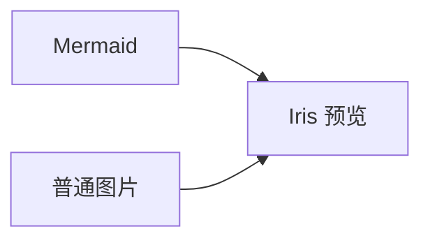

# VitePress Mermaid 与图片预览

`vitepress-plugin-mermaid-image-preview` 为 VitePress 文档提供 Mermaid 图表渲染和图片预览。读者点击图表或图片，即可在弹窗中放大、缩小和拖动，查看复杂流程或图片细节。

## 功能

- **Mermaid 自动渲染**：直接编写 `mermaid` 代码块，展示流程图、时序图等图表。
- **图片点击预览**：支持 PNG、JPEG、WebP、GIF、SVG 等普通图片，与 Mermaid 共用预览弹窗。
- **缩放与平移**：支持工具栏按钮、滚轮、鼠标拖动，以及触屏双指缩放和拖动；一键适应窗口。
- **明暗主题适配**：默认随 VitePress 明暗主题更新配色，也支持指定 Mermaid 主题和自定义颜色。
- **键盘操作**：Enter/空格打开预览，`+`/`-` 缩放，方向键平移，`0` 复位，Esc 关闭；关闭后焦点回到原图。
- **按需预览**：切换页面后仍可使用；支持自定义图片范围，也可排除指定图片。
- **错误提示**：图片加载失败时显示提示；Mermaid 语法错误时显示原因并保留源代码。

## 效果截图

### 文档中的 Mermaid 图表

Markdown 代码块直接显示为图表，点击任意图表即可打开预览。


### 放大查看图表

点击右上角 `+` 或使用滚轮放大，再拖动查看细节。工具栏显示当前比例，点击「适应窗口」回到初始视图。


### 普通图片预览

普通 Markdown 图片也可点击预览，操作方式与 Mermaid 一致，无需为每张图片单独配置。


### 深色主题

切换到深色主题后，图表与预览弹窗自动适配。


## 安装

```sh
npm install -D vitepress-plugin-mermaid-image-preview mermaid
```

支持 VitePress `^1.6.4 || ^2.0.0-0`、Vue `^3.5.0`、Mermaid `^11.0.0`。插件要求 Node 18+，实际最低版本还取决于所用 VitePress 和 Mermaid 版本。浏览器需要支持原生 `<dialog>` 和 Pointer Events。

## 两步接入

### 1. Markdown

```ts
// docs/.vitepress/config.ts
import { defineConfig } from 'vitepress';
import { mermaidPreview } from 'vitepress-plugin-mermaid-image-preview';

export default defineConfig({
  vite: {
    ssr: { noExternal: ['vitepress-plugin-mermaid-image-preview'] },
  },
  markdown: {
    config(md) {
      md.use(mermaidPreview);
    },
  },
});
```

`ssr.noExternal` 让 VitePress 正确转译发布包中的客户端 API；安装 npm 包时必须保留这项配置。

回调请使用上面的函数体写法；不要写成 `config: (md) => md.use(mermaidPreview)`，因为 `md.use()` 返回 Markdown 实例，而 VitePress 要求回调返回 `void`。

该插件只接管语言标记为 `mermaid` 的代码块（可跟标题等元数据），其余代码块保留原渲染器。请移除其他 Mermaid fence 插件，避免重复接管。

### 2. 主题

```ts
// docs/.vitepress/theme/index.ts
import DefaultTheme from 'vitepress/theme';
import { withIrisTheme } from 'vitepress-plugin-mermaid-image-preview/theme';
import 'vitepress-plugin-mermaid-image-preview/style.css';

export default withIrisTheme(DefaultTheme);
```

已有自定义主题时，也可用 `withIrisTheme(MyTheme)` 接入。需要调整图片预览范围时，传入 `selector`：

```ts
export default withIrisTheme(MyTheme, {
  selector: '.my-document img, .iris-mermaid img',
});
```

默认选择器为 `.vp-doc img, .iris-mermaid img`，不会接管站点导航 Logo。只在一个主题布局中挂载一次预览组件。

## Mermaid 主题配置

不传配置时，Mermaid 随 VitePress 明暗模式使用 `default` / `dark` 主题。可通过 `withIrisTheme` 的 `mermaid` 选项指定主题：

```ts
export default withIrisTheme(DefaultTheme, {
  mermaid: { theme: 'forest' },
});
```

`forest` 内置主题效果：


Mermaid 11 支持 `default`、`dark`、`forest`、`neutral` 和 `base`。自定义配色时使用 `base`，并传入 `themeVariables`：

```ts
export default withIrisTheme(DefaultTheme, {
  mermaid: {
    theme: 'base',
    themeVariables: {
      primaryColor: '#e0f2fe',
      primaryTextColor: '#0f172a',
      primaryBorderColor: '#0284c7',
      lineColor: '#64748b',
      fontFamily: 'system-ui, sans-serif',
    },
  },
});
```

上述 `base` 自定义配色效果（与 `forest` 使用相同图表和缩放比例）：


显式指定 `theme` 后，切换 VitePress 明暗模式仍使用该主题。颜色请使用十六进制值；更多变量见 [Mermaid 官方主题文档](https://mermaid.js.org/config/theming.html)。`selector` 和 `mermaid` 可同时配置。

## 文档写法

````md



````

带链接图片的普通点击会打开预览，Ctrl/Cmd 点击保留浏览器原链接行为。图片或祖先添加 `data-iris-no-preview` 可排除预览：

```html

```

## 操作

| 操作     | 输入                                            |
| -------- | ----------------------------------------------- |
| 打开     | 点击图片；聚焦后 Enter/空格                     |
| 缩放     | `+`/`-` 按钮或按键；滚轮；双指手势              |
| 平移     | 鼠标/触屏拖动；方向键，Shift 加速               |
| 适应窗口 | 工具栏按钮；`0`                                 |
| 关闭     | Esc；关闭按钮；点击图片或图表外的背景（含遮罩） |

100% 表示初始适应窗口比例，缩放范围为其 10%–800%。

## 使用须知

- 默认接管文档正文中的图片，不接管站点导航 Logo；界面文字目前为中文。
- 插件不调用外部渲染服务。普通图片沿用原图片地址，远程图片仍需访问其来源。
- Mermaid 以严格安全模式输出 SVG 图片，图内链接与 Mermaid 点击回调不执行。

问题反馈请前往 [GitHub Issues](https://github.com/Sinosaurus/vitepress-plugin-mermaid-image-preview/issues)。

## License

MIT
